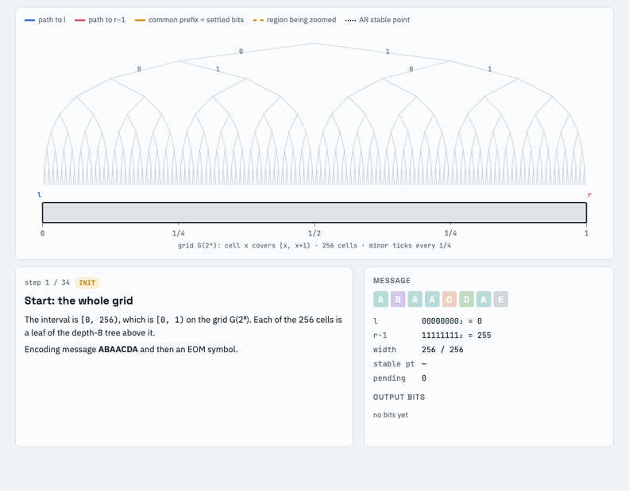
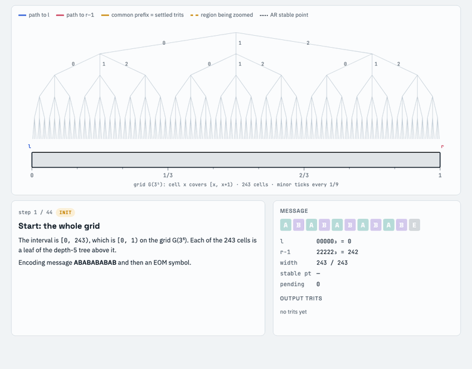
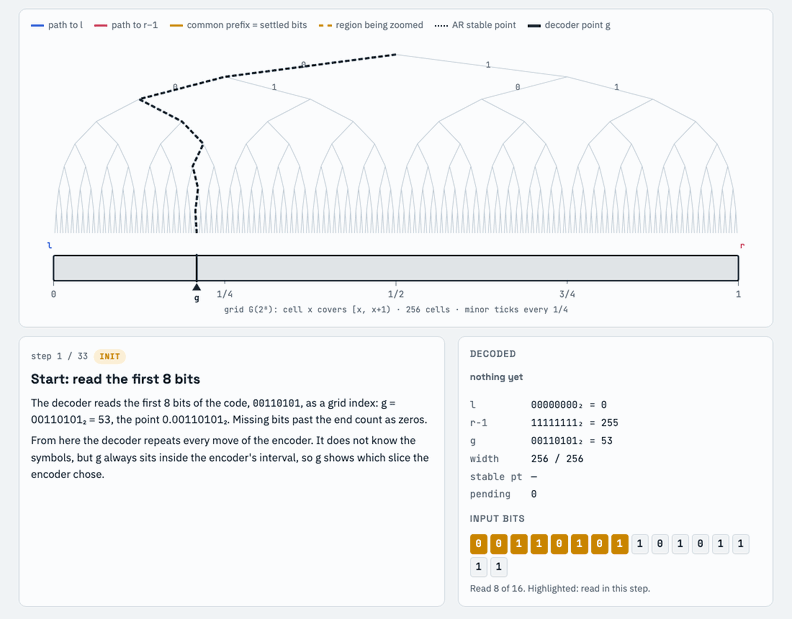
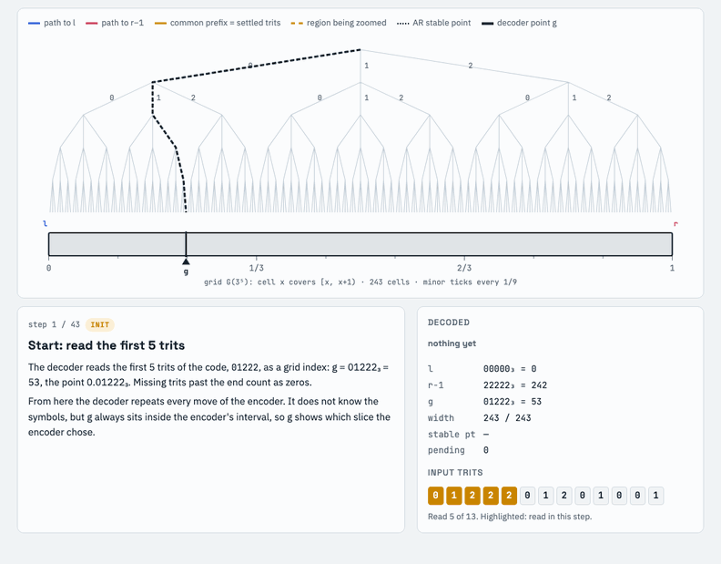

# PadicCoding.jl

[](https://github.com/ayarodionov/PadicCoding.jl/actions/workflows/CI.yml)

A Julia package implementing the compression algorithm from

> A. Rodionov and S. Volkov, "p-Adic arithmetic coding", *Contemporary
> Mathematics*, 508, 201–213, 2010.
>
> A. Rodionov and S. Volkov, "p-Adic arithmetic coding", 29 pp., 2007,
> <http://arxiv.org/abs/0704.0834v1>
> (`p-adic_arithm_coding.pdf` in this directory).

The coder is a generalization of integer arithmetic coding. A message is
mapped to a semi interval of `[0, 1)` whose edges lie on an equidistant grid
`G(P^N)` (`P` prime); edge points are kept as integer indexes in the ring
mod `P^N`. The *IP* transformation (operator `^` of the paper) maps a grid
index to the p-adic integer number of the path leading to it on the coding
P-tree — it simply reverses the `N` base-P digits. Whenever the paths to the
two interval edges get a common prefix (their p-adic distance drops below 1),
that prefix is pushed to the output and the interval is rescaled (*PR*
rescaling). The revised algorithm adds *AR* rescaling, based on the ordinary
Archimedean distance, for intervals straddling a level-1 grid point; together
the two rescalings keep the interval width at least `1/P^2 + 1/P^N`, so the coder
works with fixed-precision integers on arbitrarily long messages. For `P = 2`
the algorithm is an integer variant of classic arithmetic coding; for special
models it reproduces Huffman and Golomb-Rice codes exactly.

## Animations

Click an animation to open the interactive version, where you can step back and forth, type your own
message or code, and change the model frequencies. Both pages are listed at
<https://ayarodionov.github.io/PadicCoding.jl/>.

<table>
<tr><th></th><th><code>P = 2</code>, grid G(2<sup>8</sup>)</th><th><code>P = 3</code>, grid G(3<sup>5</sup>)</th></tr>
<tr><th>Encode</th>
<td><a href="https://ayarodionov.github.io/PadicCoding.jl/padic2.html"></a></td>
<td><a href="https://ayarodionov.github.io/PadicCoding.jl/padic3.html"></a></td></tr>
<tr><th>Decode</th>
<td><a href="https://ayarodionov.github.io/PadicCoding.jl/padic2.html"></a></td>
<td><a href="https://ayarodionov.github.io/PadicCoding.jl/padic3.html"></a></td></tr>
</table>

The tree paths to the interval edges `l` and `r−1` are blue and red; their common prefix (amber) is
what PR rescaling outputs. Dashed outlines mark the region that is zoomed to the full grid. In the
decoder, the black marker `g` is the point read from the code; it always lies in the slice of the
next symbol. The pages are plain HTML with no build step, so they also work when opened from a clone.

## Files

| File | Contents |
|---|---|
| `src/PadicCoding.jl` | Reference implementation for any prime `P`: module `PadicCoding` |
| `src/PadicCoding2.jl` | Optimized `P = 2` specialization: submodule `PadicCoding2` |
| `test/runtests.jl` | Test suite (paper examples, roundtrips, cross-checks) |
| `demos/benchmark.jl` | Throughput benchmark of all coders |
| `demos/demo.jl` | Compresses a text file and prints the rate vs. entropy |
| `demos/ip_demo.jl` | IPv4 address list compression (flat vs. per-octet-position model) |
| `demos/ipv6_demo.jl` | IPv6 address list compression (flat vs. per-byte-position model) |
| `demos/ipv6_split_demo.jl` | IPv6 compression with a dictionary prefix model + per-field coding |
| `demos/kalman_demo.jl` | Numeric signal compression with Kalman-filter predictive models (adaptive coder) |
| `demos/ternary_demo.jl` | Binary vs. ternary coding: arithmetic (P = 2, 3) and Huffman (D = 2, 3) rates, radix-economy cost |
| `demos/dna_demo.jl` | DNA storage without homopolymers: P = 3 coder + rotating code vs. ternary Huffman (Goldman et al.) |
| `demos/pam3_demo.jl` | PAM-3 link: P = 3 coder vs. P = 2 coder + bits-to-trits block codes |
| `demos/composite_p_test.jl` | Stress test for composite `P` (4, 6, 10, 256, ...) and for the width bound |
| `docs/padic2.html`, `docs/padic3.html` | Interactive encode / decode animations for `P = 2` and `P = 3` (served by GitHub Pages) |
| `docs/img/*.gif` | Recorded runs of the animations, shown above |
| `demos/cpp/padic2.hpp` | C++ port of `PadicCoding2` (bit-identical `P = 2` coder) |
| `demos/cpp/padic2_bench.cpp` | C++ throughput benchmark, matches `demos/benchmark.jl`'s workload |
| `p-adic_arithm_coding.pdf` | The paper |

No external packages are required (only `Test`, `Random`, `Printf` from the
standard library).

## Installation

```julia
using Pkg
Pkg.add(url = "https://github.com/ayarodionov/PadicCoding.jl")
```

or, for local development from a clone:

```julia
Pkg.develop(path = "path/to/PadicCoding.jl")
```

## Usage

```julia
using PadicCoding

# Static model: alphabet 1..4 with weights 1/2, 1/4, 1/8, 1/8
# (an EOM symbol with frequency 1 is appended automatically).
m = PadicModel([4, 2, 1, 1]; P = 2, N = 32)

msg  = [1, 2, 1, 1, 3, 4, 1]          # symbols are 1-based indexes
bits = padic_encode(m, msg)           # Vector{Int} of P-bits (0 .. P-1)
@assert padic_decode(m, bits) == msg
```

The optimized binary coder has the same interface and produces bit-identical
output for the same frequencies and `N` (exported by `using PadicCoding` as
well):

```julia
m2   = PadicModel2([4, 2, 1, 1]; N = 32)
bits = padic_encode2(m2, msg)         # packed BitVector
@assert padic_decode2(m2, bits) == msg
```

Run the tests, demo and benchmark from a clone with

```
julia --project -e 'using Pkg; Pkg.test()'
julia --project demos/demo.jl [file]
julia --project demos/benchmark.jl [file]
julia --project demos/ip_demo.jl
julia --project demos/ipv6_demo.jl
julia --project demos/ipv6_split_demo.jl
julia --project demos/kalman_demo.jl
julia --project demos/ternary_demo.jl
julia --project demos/dna_demo.jl
julia --project demos/pam3_demo.jl
julia --project demos/composite_p_test.jl
```

## API

### `PadicCoding` (any prime `P`)

- `PadicModel(freqs; P = 2, N)` — static frequency model over the alphabet
  `1 .. length(freqs)`; appends an EOM symbol with frequency 1. The total
  frequency must not exceed `P^(N-2) + 1` (the width guarantee of the
  revised algorithm, see the implementation notes). Internally all indexes
  are `Int128`.
- `padic_encode(m, msg)` / `padic_decode(m, bits)` — revised algorithm with
  PR + AR rescaling (pseudocode on pp. 25–27 of the paper). This is the pair
  to use.
- `padic_encode_pr(m, msg)` / `padic_decode_pr(m, bits)` — basic algorithm
  with PR rescaling only (pp. 17–19), kept for study and comparison.
- `eom(m)` — index of the EOM symbol.

### `PadicCoding2` (optimized, `P = 2` only)

- `PadicModel2(freqs; N)` with `2 ≤ N ≤ 62` and total frequency at most
  `2^(N-2) + 1`.
- `padic_encode2(m, msg) -> BitVector`, `padic_decode2(m, bits)`.
- `padic_encode2(model_at, msg)`, `padic_decode2(model_at, bits)` — adaptive
  coding: symbol `t` uses the model `model_at(t, prefix)`, where `prefix` holds
  the symbols before `t` (the EOM uses `t = length(msg) + 1`). `model_at` is
  called once per step, in order, so it may be a stateful closure (an adaptive
  counter, a Kalman filter, a neural predictor, ...); the decoder must use a
  fresh, identical copy of it. All models must share `N`.

The specialization lowers the p-adic machinery to word operations on
`UInt64`: `^` is a hardware `bitreverse`, `ord_2`/`com` is `trailing_zeros`
of an XOR, `cut`/`res`/`lift` are shifts and masks, the ring mod `2^N` is
plain masking, and the AR stable point is hardwired to 1.

## Kalman-filter demo

`demos/kalman_demo.jl` codes a synthetic 1-D GPS-like track (20 000 24-bit
samples switching between parked / cruise / maneuver / noisy "urban canyon"
regimes, with rare multipath outliers). Each sample is a residual bin around a
predicted centre (or an escape + raw value), with the per-step distribution
from the adaptive coder:

| Model | bits/sample | vs raw |
|---|---|---|
| static delta histogram (two-pass, table not counted) | 8.07 | 2.97x |
| adaptive delta counter | 7.41 | 3.24x |
| best single Kalman filter (hindsight-tuned) | 7.29 | 3.29x |
| mixture of 6 Kalman filters, likelihood-weighted with forgetting | **5.72** | **4.19x** |

The Kalman predictive Gaussian `N(mu, S)` supplies both the centre and a
calibrated width; mixing filters with different noise levels lets the model
follow regime changes, which no single fixed filter can.

## Binary vs. ternary demo

`demos/ternary_demo.jl` asks whether a ternary machine (digits 0, 1, 2)
compresses better because 3 is closer to `e` than 2. It codes four sources in
both bases and converts the output to bits (1 trit = log2 3 = 1.585 bits):

| Source | arith P=2 | arith P=3 | Huffman D=2 | Huffman D=3 | cost P=2 / P=3 |
|---|---|---|---|---|---|
| uniform {1/3, 1/3, 1/3} | 1.5858 | 1.5858 | 1.6663 | **1.5850** | 95148 / 90045 |
| dyadic {1/2, 1/4, 1/4} | 1.4961 | 1.4962 | **1.4955** | 1.5850 | 89768 / 84960 |
| uniform bytes | 8.0004 | 8.0006 | **8.0000** | 8.0504 | 480024 / 454302 |
| text bytes | 4.0961 | 4.0961 | 4.1392 | 4.1932 | 245764 / 232590 |

Rates are bits/symbol for 30 000 symbols. Information does not depend on the
base: the arithmetic coder reaches the entropy for both `P`. A symbol-by-symbol
Huffman code is better only in the base that matches the probabilities. The
`e` argument is *radix economy*: if a digit cell costs in proportion to its
number of states, storing information costs `b / ln b` per nat, which is
smallest at `b = e`. Ternary is 5.36% cheaper than binary in that model (the
last column, digits × radix), but the compressed output is no smaller.

## DNA storage demo

DNA synthesis and sequencing make many errors on homopolymers (runs of the
same base). Goldman et al. (*Nature* 494, 2013) avoid them completely with a
*rotating code*: data is written as trits, and each trit selects one of the 3
bases that differ from the previous base. The channel is then exactly
ternary, `log2 3 = 1.585` bits per nucleotide (nt). They produce the trits
with a ternary Huffman code over bytes. `demos/dna_demo.jl` uses the same
static byte model for three paths and decodes each one back from the DNA
string:

| Path (150 KB of `/usr/share/dict/words`) | nt | nt/byte | vs. P = 3 | longest run | runs ≥ 4 |
|---|---|---|---|---|---|
| floor: entropy / log2 3 | 393 043 | 2.6203 | | | |
| ternary Huffman + rotating code (Goldman) | 402 700 | 2.6847 | +2.45% | 1 | 0 |
| **P = 3 coder + rotating code** | **393 055** | **2.6204** | 0 | 1 | 0 |
| P = 2 coder, 2 bits per base | 311 488 | 2.0766 | −20.75% | 10 | 3 712 |

- The P = 3 coder writes trits directly and ends 12 nt above the floor. The
  Huffman code spends a whole number of trits on each byte and loses 2.45%
  here (1.6% on the project's own text and source).
- Writing 2 bits per base is 21% denser, but it gives thousands of runs of 4
  or more equal bases. The rotating code never repeats a base.
- In a real system the stream is cut into short oligos with indexes and
  redundancy. An arithmetic code makes one substitution corrupt the rest of
  its block, while Huffman resynchronizes, so each block would be coded on its
  own. With this coder every block pays for its EOM symbol (frequency 1 of
  about 150 000, so `log3 150000 ≈ 11` trits): 10.4 extra trits per block,
  measured. That beats Huffman only for blocks above about 160 bytes
  (≈ 425 nt); on 100-nt oligos it costs +10.5%. Short oligos would need a
  known block length instead of an EOM symbol, which the coder does not have
  yet.

## PAM-3 demo

A PAM-3 link sends one of 3 voltage levels per symbol, at most
`log2 3 = 1.585` bits. Binary data is converted to symbols with small block
codes. `demos/pam3_demo.jl` converts the output of the P = 2 coder with
several block codes and with one whole-message base conversion, and compares
it with the P = 3 coder, which writes symbols directly. Every path is decoded
and checked:

| Path (150 KB of `/usr/share/dict/words`) | symbols | vs. P = 3 |
|---|---|---|
| raw bytes, 3 bits → 2 symbols (no compression) | 800 000 | +103.5% |
| P = 2 coder, 3 bits → 2 symbols (94.6% efficient) | 415 318 | +5.66% |
| P = 2 coder, 11 bits → 7 symbols (99.1%) | 396 445 | +0.86% |
| P = 2 coder, 19 bits → 12 symbols (99.9%) | 393 468 | +0.11% |
| P = 2 coder, whole message converted to base 3 | 393 055 | 0.00% |
| **P = 3 coder, direct** | **393 055** | 0 |

The floor is 393 043 symbols; the project's own text gives the same
percentages.

- Against 3 bits → 2 symbols, the P = 3 coder saves the expected 5.7%
  (`1 − 1.5 / log2 3`).
- Larger block codes recover almost all of it: 19 bits → 12 symbols is only
  0.11% behind. Converting the whole message as one big integer matches the
  P = 3 coder exactly, but it needs the whole message first and big-integer
  arithmetic.
- So the P = 3 coder is not better at compression here. Its advantage is that
  it needs no separate conversion stage: it is a streaming, fixed-precision
  coder that already speaks the channel's alphabet.

## Performance

`benchmark.jl` on an Apple-silicon Mac, Julia 1.12, 10^6 symbols of a skewed
256-symbol source (~7.15 bits/symbol entropy; output rate matches it for
every coder):

| Coder | Encode | Decode |
|---|---|---|
| `PadicCoding`, PR+AR, P=2, N=40 | 0.2 MB/s | 0.2 MB/s |
| `PadicCoding`, PR+AR, P=3, N=26 | 0.4 MB/s | 0.3 MB/s |
| `PadicCoding`, PR+AR, P=5, N=18 | 0.6 MB/s | 0.5 MB/s |
| `PadicCoding2`, P=2, N=40 | **23 MB/s** | **8.7 MB/s** |

`demos/cpp/padic2.hpp` is a direct C++ port of `PadicCoding2` (same PR+AR
algorithm lowered to `uint64_t` word ops, bit-identical output). Built with
`g++ -O3`, it runs the same 10^6-symbol benchmark at roughly 25 MB/s encode /
9 MB/s decode — modestly faster than the Julia specialization, since Julia's
JIT already compiles this kind of tight bit-manipulation loop to comparably
efficient native code:

```
g++ -O3 -std=c++17 demos/cpp/padic2_bench.cpp -o padic2_bench
./padic2_bench
```

## Implementation notes

- **`selectPoint`** (the shortest-path point of the final interval) is found
  in `O(N·P)` instead of scanning the interval: minimizing the path as a
  p-adic integer is equivalent to minimizing the index digits
  lexicographically from the least significant one up, which is done greedily
  digit by digit.
- **Trailing zeros** of the final point are dropped, as the paper prescribes
  (`lnz`); the decoder's bit reader pads an exhausted stream with zeros.
- **A deviation from the literal pseudocode:** in the encoder's AR flush the
  `toLeft?`/`toRight?` branches are `if`/`elseif`, not two independent `if`s.
  After the first branch fires and resets `sp = 0`, the literal second `if`
  can trigger spuriously when `r = 0` (since `r^ == sp` becomes `0 == 0`) and
  would emit an invalid `sp - 1 = -1` digit.
- **PR-only coder and straddling intervals:** the paper notes that a message
  interval straddling a level-1 point defeats PR rescaling (nothing is ever
  pushed). In exact arithmetic the interval would shrink forever; with integer
  truncation the straddle eventually breaks and the PR-only coder survives
  with a small compression loss. It can still fail (`message interval too
  narrow`) for unlucky model/message combinations — the PR+AR coder cannot.
- **Width bound, corrected:** the paper (p. 25) states that PR and AR keep the
  interval at least `2/P^2 - 1/P^N` wide and so allows total frequency up to
  `2*P^(N-2) - 1`. That is too optimistic. After PR rescaling the interval
  straddles a level-1 point, and AR applies only when `l[1] == P-1` *and*
  `r[1] == 0`. If either fails, one edge is at least `1/P^2` from the point,
  so the interval is only guaranteed `1/P^2 + 1/P^N` wide, i.e.
  `P^(N-2) + 1` grid cells, and that is the limit on the total frequency.
  Example: `P = 2`, `N = 4`, frequencies `[2, 4]` (total 7 with EOM, allowed
  by the old limit); the message `[2, 2, 2]` leaves the interval `[6, 12)`,
  width 6 < 7, and EOM cannot be coded. `demos/composite_p_test.jl` shows
  failures at the old limit for every `P` and none at the new one.
- Both `padic_encode` and `padic_encode2` implement the same algorithm and
  their outputs are bit-for-bit identical; the test suite cross-decodes
  streams between the two implementations.
